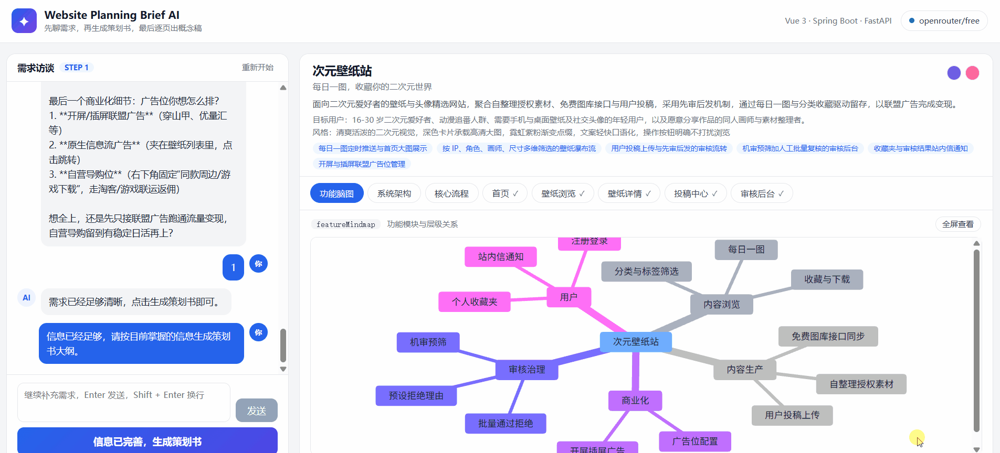

# Website Planning Brief AI

**一个自带产品经理和架构师思维的 AI 建站助手。**

你说一句「我想做一个咖啡社区」，它会像真正的产品经理一样追问需求盲区，然后输出一份完整的网站策划书、三张 Mermaid 架构图，以及可以直接预览的页面概念稿。Web 和 MCP 两种形态，随时可用。

[](https://vuejs.org)
[](https://spring.io/projects/spring-boot)
[](https://fastapi.tiangolo.com)
[](https://modelcontextprotocol.io)
[](#license)



> 🎬 演示占位：把 Web 端录屏保存为 `assets/demo.gif` 即可自动显示。
> 建议录制路径：一句想法 → 多轮追问 → 生成策划书 → 三张图表 → 全屏页面预览。

## ✨ 核心特性

- **🔑 BYOK，模型自由**：自带 API Key，兼容任意 OpenAI 协议服务（智谱 GLM、DeepSeek、Moonshot、自建网关）。服务端不保存密钥。
- **🧠 不像问卷的产品经理**：不是逐项收集表单，而是顺着你提到的功能联想配套能力——提到个人中心就追问好友私信，提到详情页就追问导航推荐，每轮只问一个关键问题。
- **🗺 三图齐发**：一次生成功能脑图、系统架构图、核心业务时序图（Mermaid），浏览器内直接渲染，支持全屏。
- **🖥 双形态**：可视化 Web 工作台，加上独立 MCP Server。在 Cursor / Codex / Claude Desktop 里用自然语言直接生成。
- **📦 结构化产物**：策划书 JSON + 每页独立的现代风格静态 HTML，iframe 即开即看，可作为开发前的原型基线。
- **🔐 密钥不落库**：Web 端存在浏览器 sessionStorage，MCP 端只读进程环境变量，全程不写日志、不落盘。

## 🚀 快速开始

### Web 端（3 分钟）

前置：Python 3.11+、JDK 17+、Node 20+。

```powershell
# 安装依赖（只需一次）
git clone https://github.com/XiangDong-luncky/Website-Planning-Brief-JSON.git
cd Website-Planning-Brief-JSON
python -m venv ai-service\.venv
ai-service\.venv\Scripts\python.exe -m pip install -r ai-service\requirements.txt
cd frontend; npm install; cd ..
```

启动时开三个终端，在仓库根目录各执行一行：

```powershell
# 终端 1：AI 层
cd ai-service; .venv\Scripts\python.exe -m uvicorn main:app --port 8000

# 终端 2：Spring Boot
cd backend; mvn spring-boot:run

# 终端 3：前端
cd frontend; npm run dev
```

打开 **http://localhost:5173** → 点右上角「配置模型」填入你的 Key → 开始聊天。

> macOS / Linux 把 `.venv\Scripts\python.exe` 换成 `.venv/bin/python` 即可。

<details>
<summary><b>没有 Key？先离线看效果</b></summary>

在 `ai-service/.env` 中设置 `MOCK_LLM=1` 并重启 AI 服务；前端模型设置里随便填一组非空值（如 `demo` / `https://open.bigmodel.cn/api/paas/v4` / `glm-4.7-flash`），即可用内置示例数据体验完整流程。

</details>

### 作为 MCP 插件使用

MCP Server 完全独立，不需要启动 Web 服务，也不需要 FastAPI 或 Spring Boot。

```powershell
cd mcp-server
python -m venv .venv
.venv\Scripts\python.exe -m pip install -r requirements.txt
```

<details open>
<summary><b>Cursor</b> · <code>.cursor/mcp.json</code> 或 <code>%USERPROFILE%\.cursor\mcp.json</code></summary>

```json
{
  "mcpServers": {
    "website-planning-brief": {
      "command": "D:\\path\\to\\Website-Planning-Brief-JSON\\mcp-server\\.venv\\Scripts\\python.exe",
      "args": [
        "D:\\path\\to\\Website-Planning-Brief-JSON\\mcp-server\\mcp_server.py"
      ],
      "env": {
        "OPENAI_API_KEY": "你的 API Key",
        "OPENAI_BASE_URL": "https://open.bigmodel.cn/api/paas/v4",
        "MODEL_NAME": "glm-4.7-flash"
      }
    }
  }
}
```

</details>

<details open>
<summary><b>Codex CLI</b> · <code>~/.codex/config.toml</code></summary>

```toml
[mcp_servers.website-planning-brief]
command = 'D:\path\to\Website-Planning-Brief-JSON\mcp-server\.venv\Scripts\python.exe'
args = ['D:\path\to\Website-Planning-Brief-JSON\mcp-server\mcp_server.py']
env = { OPENAI_API_KEY = "你的 API Key", OPENAI_BASE_URL = "https://open.bigmodel.cn/api/paas/v4", MODEL_NAME = "glm-4.7-flash" }
```

</details>

<details>
<summary><b>Claude Desktop</b> · <code>%APPDATA%\Claude\claude_desktop_config.json</code></summary>

和 Cursor 的 JSON 结构相同，把 `mcpServers` 条目加入配置后完全退出并重启 Claude Desktop。

</details>

配置完成后，在客户端里直接说：

> 我想做一个记录咖啡豆风味的社区网站，先帮我澄清需求。

AI 会依次调用 `chat_requirement` → `generate_outline` → `generate_page_html` 三个工具。

## 🧠 它是怎么工作的

1. **需求澄清**：AI 以产品经理视角梳理目标用户、业务闭环、异常与权限，每轮只追问一个最关键的盲区。
2. **结构化策划**：把整段对话总结成策划书 JSON，同时生成三张 Mermaid 图——功能脑图、系统架构、核心业务时序图。
3. **逐页概念稿**：点击某个页面时才单独生成该页的高精度静态 HTML，避免一次性输出过长内容，也方便反复调整单页。

## 🏗 技术架构

```
Web    Vue 3 (5173) ──► Spring Boot (8080) ──► FastAPI (8000) ──┐
                                                                ├──► OpenAI 兼容模型
MCP    Cursor / Codex / Claude ──stdio──► mcp_server.py ────────┘
```

- Web 端每个请求携带 `userConfig`（apiKey / baseUrl / modelName），由 AI 层动态创建客户端。
- MCP 端从进程环境变量读取同一组配置。
- 两端共用同一套 System Prompt、Mermaid 语法校验与自动纠错逻辑。

## 🗺 Roadmap

- [x] 多轮对话引导需求（查漏补缺）
- [x] 策划书大纲与 HTML 分离生成
- [x] BYOK 模型配置
- [x] 三张 Mermaid 图（脑图 / 架构 / 时序）
- [x] 双形态：Web 应用 + MCP Server（Cursor / Codex / Claude Desktop）
- [ ] VS Code / JetBrains 插件
- [ ] 浏览器扩展：边浏览网页边生成策划书
- [ ] Claude Desktop 一键安装包
- [ ] Docker Compose 一键启动
- [ ] 策划书导出 Markdown / PDF
- [ ] 生成任务异步化与 SSE 进度

## 📚 开发文档

<details>
<summary><b>API 接口与错误码</b></summary>

所有接口经 Spring Boot 转发，请求体必须携带：

```json
{ "userConfig": { "apiKey": "...", "baseUrl": "...", "modelName": "..." } }
```

| 接口 | 作用 |
| --- | --- |
| `POST /api/chat` | 多轮需求澄清，返回 `{ "reply": "..." }` |
| `POST /api/generate-outline` | 由完整对话生成策划书 JSON（含三张 Mermaid 图） |
| `POST /api/generate-page-html` | 由单页大纲生成完整 HTML |

错误统一为 `{ "detail": "..." }`：

| 状态码 | 场景 |
| --- | --- |
| 400 | 缺少/不完整 `userConfig`、`baseUrl` 非法、模型名不支持 |
| 401 | 模型鉴权失败 |
| 429 | 模型限流 |
| 502 | 上游异常、两次生成都未得到合法 JSON |
| 503 | Spring 连不上 AI 服务 |
| 504 | 模型请求超时 |

</details>

<details>
<summary><b>环境变量</b></summary>

`ai-service/.env`：

| 变量 | 说明 | 默认值 |
| --- | --- | --- |
| `MOCK_LLM` | `1` 时返回示例数据 | `0` |
| `ZHIPU_THINKING` | 智谱思考模式（仅智谱域名生效） | `disabled` |
| `LLM_TIMEOUT` | 单次请求超时（秒） | `180` |
| `CHAT_MAX_TOKENS` | 对话回复上限 | `1024` |
| `OUTLINE_MAX_TOKENS` | 大纲输出上限 | `8192` |
| `HTML_MAX_TOKENS` | 单页 HTML 上限 | `16000` |
| `HISTORY_CHAR_BUDGET` | 历史对话字符预算 | `24000` |

MCP Server 环境变量：`OPENAI_API_KEY`（必填）、`OPENAI_BASE_URL`、`MODEL_NAME`、`MODEL_TIMEOUT`、`MODEL_THINKING`、`CHAT_MAX_TOKENS`、`OUTLINE_MAX_TOKENS`、`HTML_MAX_TOKENS`、`HISTORY_CHAR_BUDGET`。

</details>

<details>
<summary><b>项目结构</b></summary>

```
Website Planning Brief JSON/
├── ai-service/          # AI 层：FastAPI + BYOK + Prompt + 校验
├── backend/             # 转发层：Spring Boot 3
├── frontend/            # Web 端：Vue 3 + Vite + Mermaid
├── mcp-server/          # 独立 MCP Server（stdio）
├── .gitignore
└── README.md
```

</details>

<details>
<summary><b>本地构建与验证</b></summary>

```powershell
# 后端
cd backend; mvn package

# 前端
cd frontend; npm run build

# AI 层语法检查
cd ai-service; .venv\Scripts\python.exe -m py_compile main.py
```

</details>

<details>
<summary><b>常见问题</b></summary>

- **401**：Key 无效或没有模型权限，检查 `modelName` 与 `baseUrl` 是否匹配。
- **429**：模型限流，稍后重试或更换 Key / 模型。
- **图表渲染失败**：查看 `ai-service/debug/outline_result.json` 中对应字段；服务端会按图类型校验并自动重试。
- **`127.0.0.1:5173` 打不开**：Windows 上 Vite 绑定的是 IPv6 `localhost`，用 http://localhost:5173 。
- **Cursor 看不到 MCP 工具**：检查 JSON 路径转义、`command` 是否指向 `mcp-server/.venv` 的解释器，然后重启 Cursor。
- **报 `No module named 'mcp.server.fastmcp'`**：安装的是 mcp 1.x，执行 `pip install -U "mcp>=2.0.0"`。

</details>

## 🤝 Contributing

欢迎 Issue 和 PR。提交前请确保 `mvn package`、`npm run build`、`py_compile` 均通过；涉及 Prompt 的改动请附上生成结果对比。

## License

MIT
